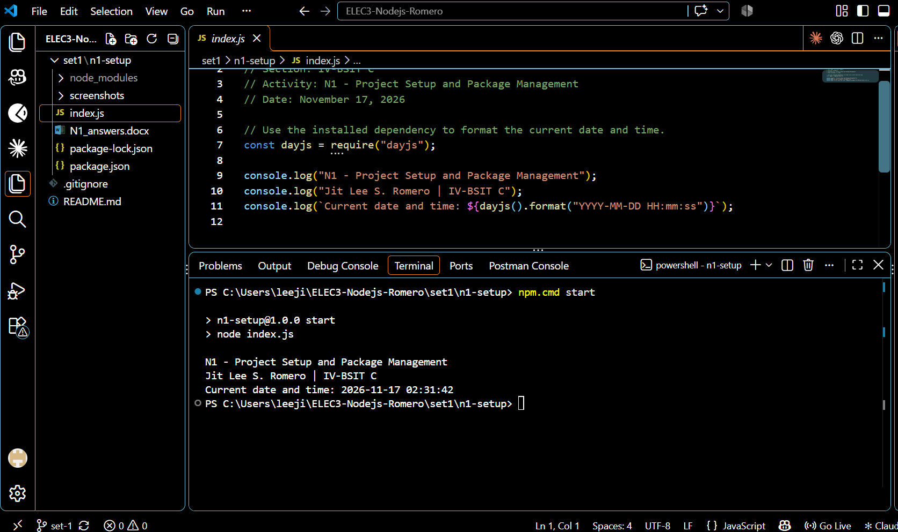
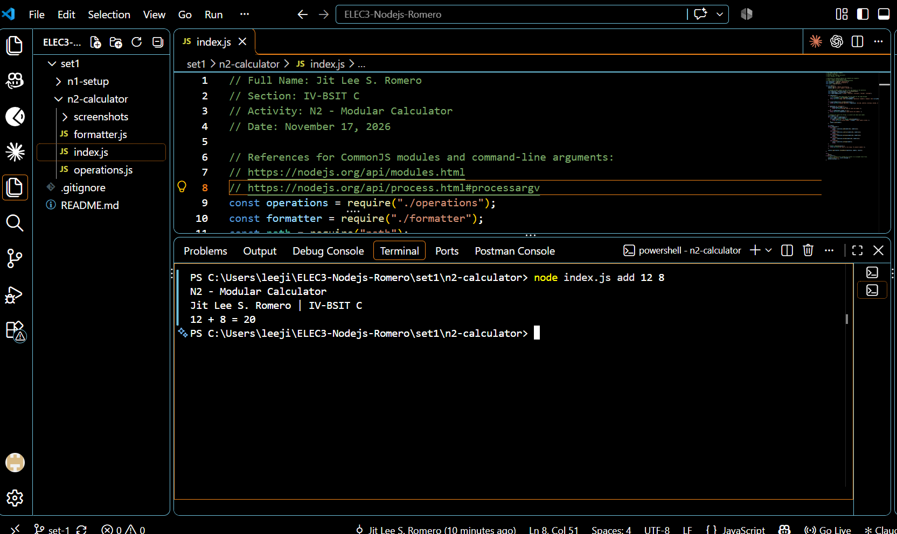
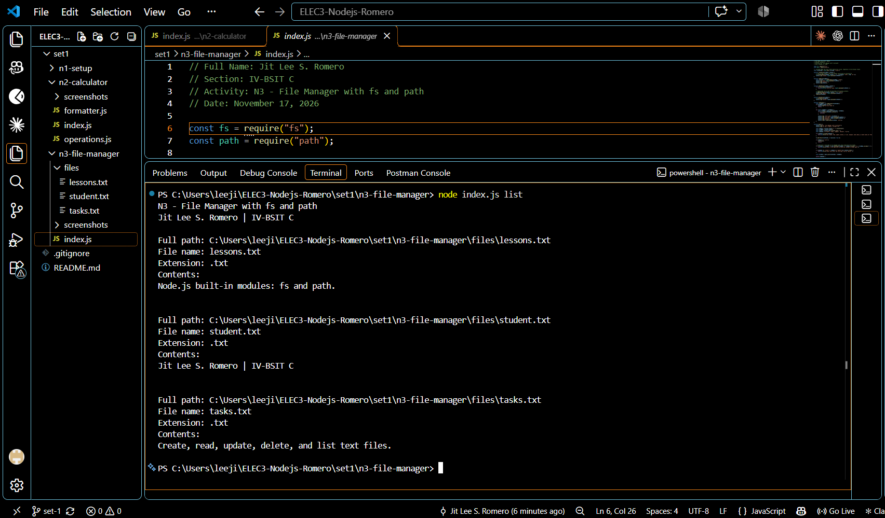

# ELEC 3 - Node.js

- **Full name:** Jit Lee S. Romero
- **Section:** IV-BSIT C
- **Course:** ELEC 3 - Node.js

Self-paced Node.js activities, organized by set and activity.

## Set 1 Activities

| Activity | Description | Folder |
| --- | --- | --- |
| N1 - Project Setup and Package Management | An npm project with complete package metadata, a regular dependency, a development dependency, and a start script that prints the student's name. | [set1/n1-setup](set1/n1-setup/) |
| N2 - Modular Calculator | A command-line calculator that uses two CommonJS custom modules, five operations, the built-in path module, and clear error messages. | [set1/n2-calculator](set1/n2-calculator/) |
| N3 - File Manager with fs and path | A command-line text file manager that creates, reads, appends, deletes, and lists files stored in its files subfolder. | [set1/n3-file-manager](set1/n3-file-manager/) |

## How to Run N1

Node.js and npm are required. The project was checked with Node.js **v24.19.0** and npm **11.17.0**.
From the repository root, enter the activity folder and run:

```sh
cd set1/n1-setup
npm install
npm start
```

In Windows PowerShell, `npm.cmd install` and `npm.cmd start` run the same npm commands if `npm.ps1` is blocked by the execution policy.

The output shows the activity title, **Jit Lee S. Romero | IV-BSIT C**, and the current date and time.

## N1 Package Management

The project was initialized using `npm init --yes`, then its name, version, description, main entry point, author, and start script were filled in.

- `npm install dayjs` installs the regular dependency used in `index.js` to format the date and time.
- `npm install --save-dev --save-exact nodemon@3.1.11` installs the development dependency. Nodemon can restart a Node.js program when its files change; it is not needed by this program's `npm start` command.
- `package.json` describes the project and its dependencies. `package-lock.json` records the resolved package versions and is included in the repository.
- The root `.gitignore` excludes `node_modules/`. Run `npm install` after cloning to restore the packages.

Nodemon is pinned to **3.1.11** after the initial installation reported a [minimatch dependency advisory](https://github.com/advisories/GHSA-g3hv-75wg-m249). The final installed dependency tree passed `npm audit` with zero reported vulnerabilities.

## N1 Written Answers

[N1_answers.docx](set1/n1-setup/N1_answers.docx) explains the required package fields and why `node_modules` is not included when submitting the project.

## N1 Screenshots

The screenshots show Node.js **v24.19.0**, npm **11.17.0**, the completed package metadata and dependency sections, and a successful run using `npm.cmd start`. The author's name is visible in the source code, package author field, or program output.



Additional screenshots:

- [Node.js and npm versions](set1/n1-setup/screenshots/N1_versions.png)
- [Completed package.json with regular and development dependencies](set1/n1-setup/screenshots/N1_package_jason.png)

## How to Run N2

N2 uses only Node.js and its built-in modules; no npm packages need to be installed for this activity.
From the repository root, enter the activity folder:

```sh
cd set1/n2-calculator
```

In PowerShell, you can enter the folder directly from any location:

```powershell
cd C:\Users\leeji\ELEC3-Nodejs-Romero\set1\n2-calculator
```

Run one command for each calculation. The operation and numbers are part of the command; the program prints the result and ends.

| Operation | Command | Expected result |
| --- | --- | --- |
| Add | `node index.js add 12 8` | `12 + 8 = 20` |
| Subtract | `node index.js subtract 12 8` | `12 - 8 = 4` |
| Multiply | `node index.js multiply 12 8` | `12 * 8 = 96` |
| Divide | `node index.js divide 12 8` | `12 / 8 = 1.5` |
| Average | `node index.js average 12 8 10` | `Average of 12, 8, 10 = 10` |
| Division by zero | `node index.js divide 10 0` | `Error: Cannot divide by zero.` |
| Unknown operation | `node index.js power 12 8` | An error naming the unknown operation and listing the supported operations. |

Add, subtract, multiply, and divide each require exactly two numbers. Average accepts one or more numbers.
Missing or invalid numbers produce readable errors. Each run displays the student's full name and section.

### N2 Modules

- [operations.js](set1/n2-calculator/operations.js) exports the five calculation functions using `module.exports`.
- [formatter.js](set1/n2-calculator/formatter.js) exports `formatResult`, which returns a readable calculation string.
- [index.js](set1/n2-calculator/index.js) imports both custom modules with `require()`, reads inputs using `process.argv`, validates them, calls the selected operation, and displays the formatted result.
- The built-in `path` module supplies `path.basename(__filename)` for the usage message shown when running `node index.js` without an operation.

API references: [Node.js CommonJS modules](https://nodejs.org/api/modules.html), [process.argv](https://nodejs.org/api/process.html#processargv), and [path.basename](https://nodejs.org/api/path.html#pathbasenamepath-suffix).

### N2 Screenshots

The seven screenshots show all five operations and both required error cases using the commands above. The student's full name and section are visible in every run.



| Case | Screenshot |
| --- | --- |
| Add | [12 + 8 = 20](set1/n2-calculator/screenshots/N2_ADD.png) |
| Subtract | [12 - 8 = 4](set1/n2-calculator/screenshots/N2_SUBTRACT.png) |
| Multiply | [12 * 8 = 96](set1/n2-calculator/screenshots/N2_MULTIPLY.png) |
| Divide | [12 / 8 = 1.5](set1/n2-calculator/screenshots/N2_DIVIDE.png) |
| Average | [Average of 12, 8, 10 = 10](set1/n2-calculator/screenshots/N2_AVERAGE.png) |
| Division by zero | [Clear error for divide 10 0](set1/n2-calculator/screenshots/N2_DIVISION_BY_ZERO.png) |
| Unknown operation | [Clear error for power 12 8](set1/n2-calculator/screenshots/N2_UNKNOWN_OPERATION.png) |

## How to Run N3

N3 uses the built-in `fs` and `path` modules. No npm packages need to be installed for this activity.
From the repository root, enter the activity folder:

```sh
cd set1/n3-file-manager
```

In PowerShell, enter the folder directly from any location:

```powershell
cd C:\Users\leeji\ELEC3-Nodejs-Romero\set1\n3-file-manager
```

Run these commands **in order**, taking a screenshot after each one. Text in quotes is the content to save in the file.

| Command | Expected behavior |
| --- | --- |
| `node index.js create notes.txt "Hello from Jit Lee S. Romero."` | Create `files/notes.txt` and display `Created: notes.txt`. |
| `node index.js read notes.txt` | Display the saved text. |
| `node index.js update notes.txt "I am learning fs and path."` | Append a second line and display both lines. |
| `node index.js delete notes.txt` | Remove the demonstration file and display `Deleted: notes.txt`. |
| `node index.js list` | Display the full path, file name, extension, and contents of each remaining file. |

Each command displays the student's full name and section. The program performs one command and ends.
File names are supplied without a folder path; every managed file path is built using `path.join()`.
The files folder is based on `__dirname`, so running the script from a different terminal folder still uses the same files.

### N3 Source and Saved Files

[index.js](set1/n3-file-manager/index.js) contains separate functions for create, read, update, delete, and list.
It uses synchronous file operations so each step completes before the next step runs.
`list` uses `path.basename()` and `path.extname()` to display file details.

The required three text files were created by running this program's `create` command and are included in the repository:

- [student.txt](set1/n3-file-manager/files/student.txt) - the student's full name and section.
- [lessons.txt](set1/n3-file-manager/files/lessons.txt) - the modules used in N3.
- [tasks.txt](set1/n3-file-manager/files/tasks.txt) - the supported file operations.

These three files remain after deleting the demonstration file, `notes.txt`. Include the `files` folder when submitting N3.

### N3 Error Handling

Reading or deleting a missing file prints a clear `Error: File not found` message instead of an uncaught stack trace.
To try these cases after deleting `notes.txt`, run `node index.js read notes.txt` or `node index.js delete notes.txt`.
Updating a missing file also shows an error. Creating an existing file does not overwrite it; use `update` to append text instead.
Missing commands, file names, or content show a usage message.

References: [Node.js File System](https://nodejs.org/api/fs.html) and [Node.js Path](https://nodejs.org/api/path.html).

### N3 Screenshots

The five screenshots show creating and reading `notes.txt`, appending a second line, deleting it, and listing the three remaining text files. The student's name and section are visible in each screenshot.



| Operation | Screenshot |
| --- | --- |
| Create | [Created notes.txt](set1/n3-file-manager/screenshots/N3_CREATE.png) |
| Read | [Saved contents of notes.txt](set1/n3-file-manager/screenshots/N3_READ.png) |
| Update | [Original text and appended second line](set1/n3-file-manager/screenshots/N3_UPDATES.png) |
| Delete | [Deleted notes.txt](set1/n3-file-manager/screenshots/N3_DELETE.png) |
| List | [Three remaining files with full details](set1/n3-file-manager/screenshots/N3_LISTS.png) |
